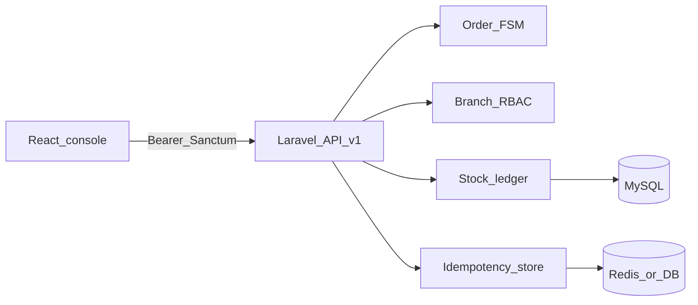
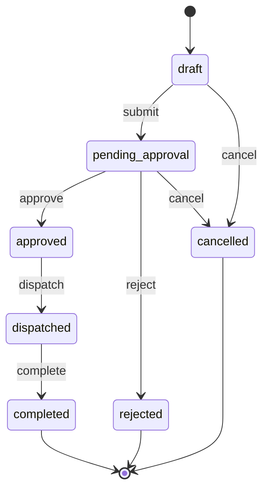

# FlowState ERP

Portfolio-grade micro-ERP for multi-branch order approval and inventory control.

**Live:** [flowstate.dorisle.tech](https://flowstate.dorisle.tech) · **API docs:** [/api/documentation](https://flowstate.dorisle.tech/api/documentation) · **Repo:** [dorisle-work/flowstate-erp](https://github.com/dorisle-work/flowstate-erp)

> One-liner for CV: *Laravel 11 + React — branch RBAC, order finite-state machine, ACID stock ledger, idempotent Sanctum API, OpenAPI.*

## Why this exists

Branch sales staff create drafts; managers approve; warehouse dispatches. Illegal status jumps, double-clicks, and silent stock drift are the failure modes this system is built to prevent.

| Hiring signal | Where it shows up |
| --- | --- |
| Domain modeling | Order FSM + approval audit log |
| Data integrity | Immutable inventory ledger (no “edit quantity in place”) |
| API safety | `X-Idempotency-Key` on mutating routes → `409` on replay |
| Authorization | Spatie-style permissions; cost/margin gated by `orders.view_cost_price` |
| Full-stack delivery | Laravel `/api/v1` + React console + L5-Swagger |

## Architecture





Stock reservation / deduction happens only on legal transitions (not on arbitrary UI edits). Reject and cancel require an audit note (≥ 10 characters).

## Stack

- **API:** PHP 8.2+ / Laravel 11 / Sanctum / MySQL  
- **Console:** React + Vite + TypeScript (`frontend/`)  
- **Local extras:** Redis (session, cache, queue, idempotency)  
- **Hostinger production:** same origin UI + `/api`; idempotency/cache/session on **database** (no Redis)

## Demo

Password for every seeded account: `password`.

| Email | Role | Branch |
| --- | --- | --- |
| `superadmin@flowstate.test` | Super Admin | all |
| `manager.hn@flowstate.test` | Branch Manager | Hà Nội |
| `manager.hcm@flowstate.test` | Branch Manager | TP.HCM |
| `sales.hn@flowstate.test` | Sales Staff | Hà Nội |
| `sales.hcm@flowstate.test` | Sales Staff | TP.HCM |
| `kho.dn@flowstate.test` | Thủ kho | Đà Nẵng |

### Smoke checklist (live or local)

1. Login as `sales.hn@flowstate.test` → create multi-line draft → submit.  
2. Login as `manager.hn@flowstate.test` → approve (or reject with note).  
3. Dispatch → complete; confirm inventory movement on ledger screen.  
4. Login as sales → confirm cost/margin hidden; Super Admin sees them.  
5. Replay a mutating request with the same `X-Idempotency-Key` → `409`.  
6. Open [/api/documentation](https://flowstate.dorisle.tech/api/documentation) → Authorize with login token → call `GET /api/v1/orders`.

## Architecture decisions

| Decision | Choice | Why |
| --- | --- | --- |
| Order status | Explicit FSM + actions | Illegal transitions fail in the domain layer, not “if status ==” in controllers |
| Stock | Append-only ledger | Auditable quantity history; UI never writes balances directly |
| Mutations | Idempotency middleware | Protects double-submit and flaky clients |
| Permissions | Permission matrix API + UI | Recruiters can toggle grants and see cost fields appear/disappear |
| Frontend default | Mock adapter (`VITE_USE_MOCK`) | Demo UI without PHP; production Hostinger build sets mock off |
| Hostinger hosting | Same origin `/api` | Nested subdomain `api.flowstate…` rejected by Hostinger wizard |
| Shared hosting | `IDEMPOTENCY_STORE=database` | No Redis on typical shared plans |

More product intent: [`PRODUCT.md`](PRODUCT.md).

## API

Authenticate: `POST /api/v1/auth/login` → `Authorization: Bearer {token}`.

Mutating routes behind `idempotency` middleware require `X-Idempotency-Key` (8–128 chars).

```text
GET    /api/v1/branches|customers|products|accounts|inventories|orders|notifications
POST   /api/v1/orders
PATCH  /api/v1/orders/{order}          # draft only
POST   /api/v1/orders/{order}/{submit|approve|reject|dispatch|complete|cancel}
POST   /api/v1/inventories/adjust|receive
PATCH  /api/v1/roles-matrix
```

Create-order body accepts camelCase from the UI:

```json
{
  "customerId": 101,
  "branchId": 1,
  "lines": [{ "sku": "FS-001", "quantity": 2 }]
}
```

Swagger: local [http://127.0.0.1:8000/api/documentation](http://127.0.0.1:8000/api/documentation) · prod [https://flowstate.dorisle.tech/api/documentation](https://flowstate.dorisle.tech/api/documentation)

```bash
php artisan l5-swagger:generate
```

## Run locally

### Docker

```bash
cp .env.example .env
php artisan key:generate
docker compose up -d --build
docker compose exec app php artisan migrate --seed
```

API: `http://localhost:8000` · MySQL host port `3307`.

### Homebrew PHP + MySQL + Redis

XAMPP PHP 7.4 cannot run this project.

```bash
brew services start mysql@8.0
brew services start redis
composer install
cp .env.example .env
php artisan key:generate
php artisan migrate --seed
php artisan serve
```

```bash
cd frontend && npm install && npm run dev
```

Live API from Vite:

```bash
# frontend/.env.local
VITE_USE_MOCK=false
VITE_API_URL=http://127.0.0.1:8000
```

Set `FRONTEND_URL` in Laravel `.env` for CORS.

## Deploy (Hostinger — one domain)

| Path | Serves |
| --- | --- |
| `/` | React SPA (`public/client`) |
| `/api/v1/...` | Laravel API |
| `/api/documentation` | Swagger |

Env template: [`.env.hostinger.example`](.env.hostinger.example).

```bash
cd frontend && npm ci && npm run build:hostinger
```

Upload into `public_html` (document root cannot leave `public_html` on many plans):

```text
public_html/
  index.php .htaccess client/ favicon.svg …
  laravel/          # app, bootstrap, config, routes, vendor, .env, …
    .htaccess       # deploy/hostinger/laravel.htaccess
```

```bash
cd ~/domains/flowstate.dorisle.tech/public_html/laravel
composer install --no-dev --optimize-autoloader
php artisan key:generate --force
php artisan migrate --force --seed
php artisan l5-swagger:generate
php artisan config:clear
# optional after env is correct:
# php artisan config:cache && php artisan route:cache
```

`public/index.php` resolves either `../` (normal) or `./laravel` (Hostinger layout).

## Tests

```bash
php artisan test
```

Feature coverage centers on order workflow transitions and idempotency conflicts.
